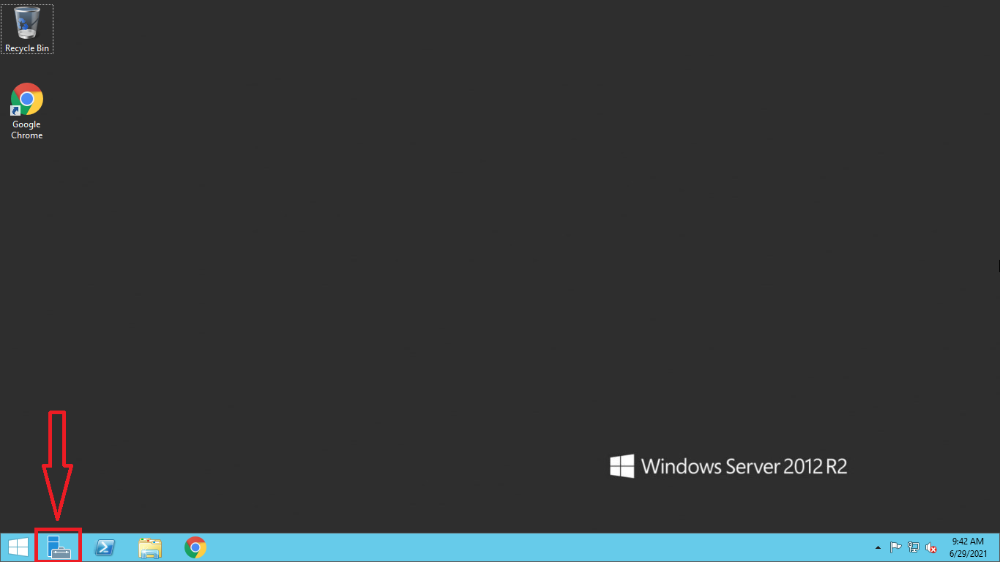
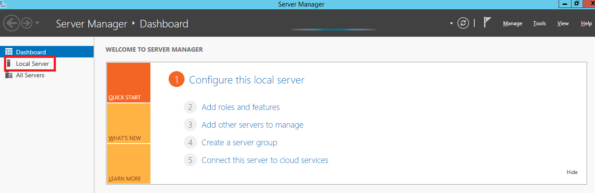
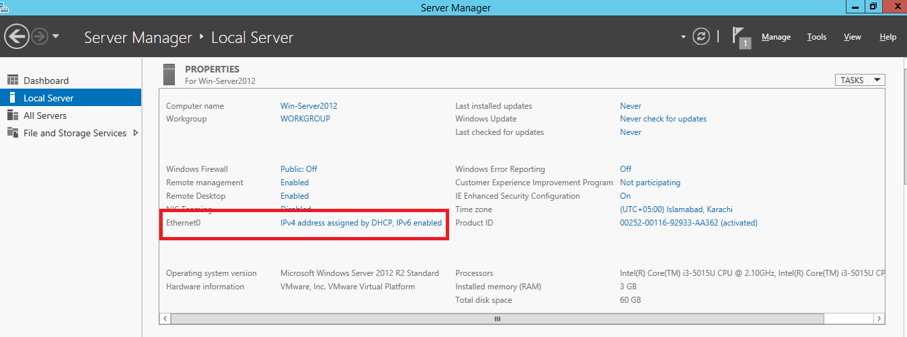
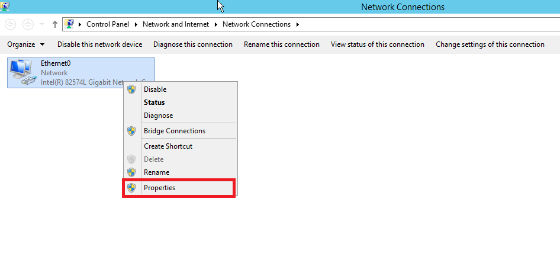
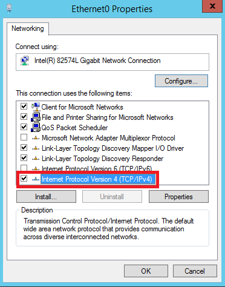
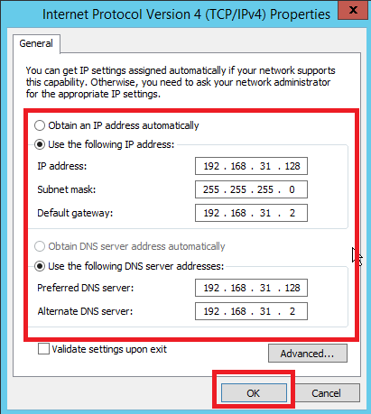

# Lab 1: Assigning a Static IP Address to a Server

> **Objective:** Assign a static IPv4 address and preferred DNS server to a Windows Server 2012 R2 machine before promoting it to a domain controller.

**Step 1.** Click Server Manager.

**Step 2.** In Server Manager Dashboard, Click Configure this local server.

**Step 3.** In Local Server, select Ethernet IPv4 address assigned by DHCP.

**Step 4.** Right click Ethernet, select Properties.

**Step 5.** Select Internet Protocol Version 6 (TCP/IPv6) and uncheck the box.

**Step 6.** Select Internet Protocol Version 4 (TCP/IPv4) and click Properties.

**Step 7.** Select Use the following IP address and enter the IP address and click Subnet mask, it will be entered automatically and select Use the DNS Server addresses and enter the Preferred DNS Server address and Click OK and OK.

---
[← Fundamentals](../fundamentals/) | [Active Directory](../README.md) | [Lab 2 →](../lab-02-install-active-directory/)
