# Lab 2: Installing and Configuring Active Directory

> **Objective:** Install the Active Directory Domain Services role and promote the server to the first domain controller of a new forest, `Bkteam.com`.

**Step 1.** Log in as Administrator to the Workgroup Computer.

**Step 2.** Assign IP Address and preferred DNS Server Address.

**Step 3.** Click Server Manager.

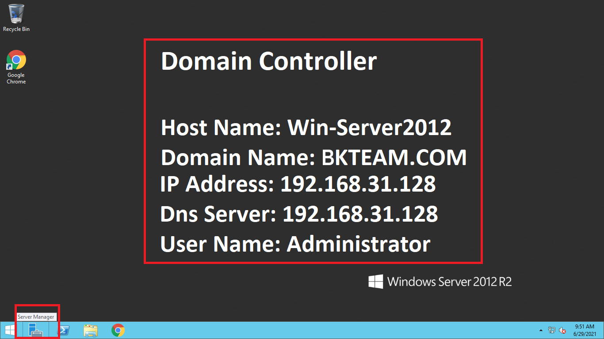

**Step 4.** In Server Manager Dashboard, Click Add roles and features.

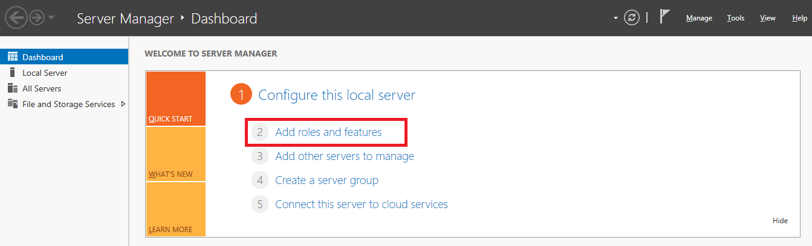

**Step 5.** In Before you begin page, click Next.

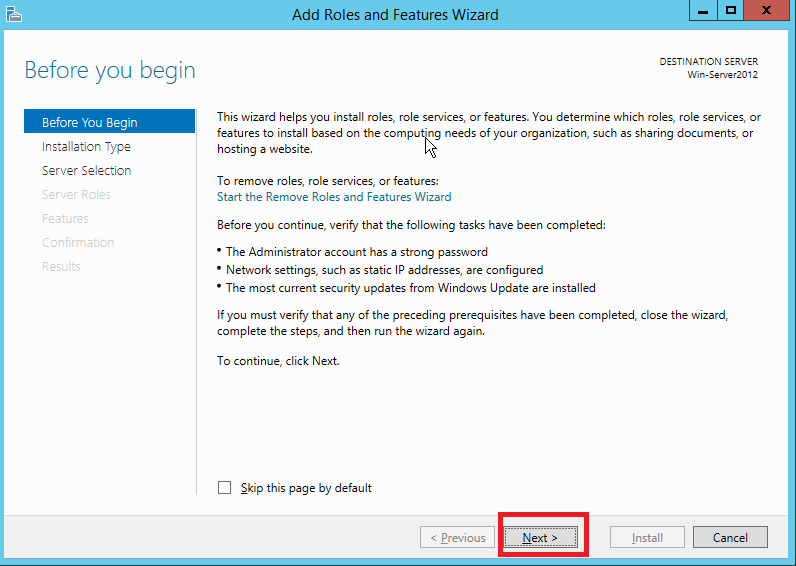

**Step 6.** In Select installation type, select Role-based or feature-based installation, click Next.

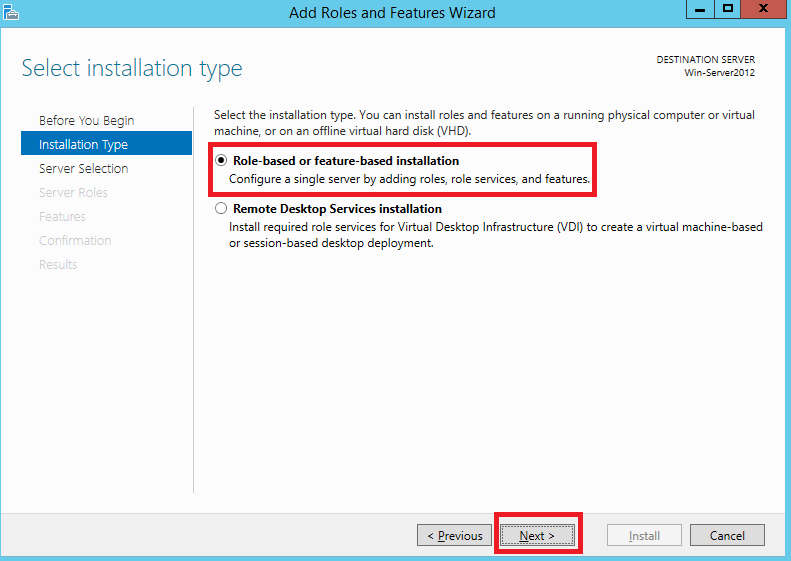

**Step 7.** In Select destination server from Server Pool select Win-Server 2012, click Next.

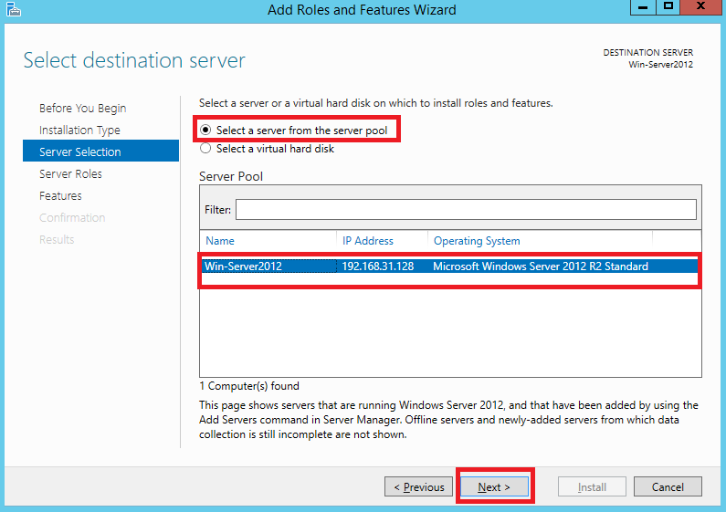

**Step 8.** In Roles, check the box Active Directory Domain Services.

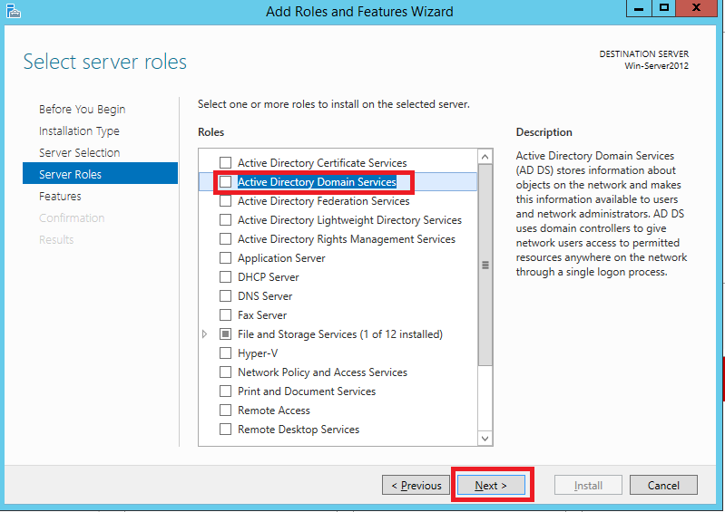

**Step 9.** Click Add Features, to install the required features for Active Directory Domain Services. Click Next.

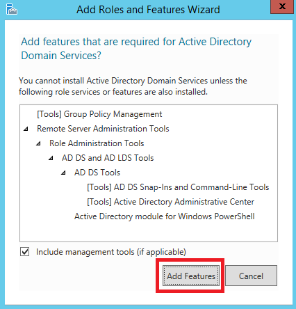

**Step 10.** In Select features wizard, click Next.

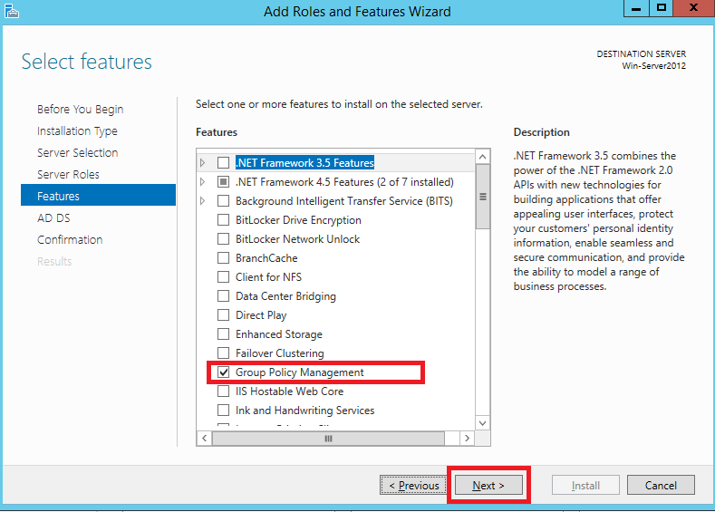

**Step 11.** In Active Directory Domain Services wizard, click Next.

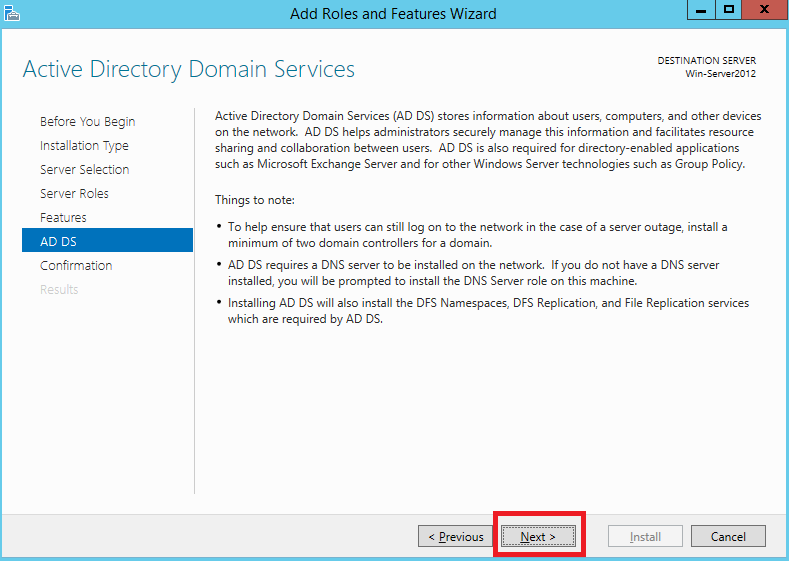

**Step 12.** Check the box Restart the destination server automatically if required. Click Install.

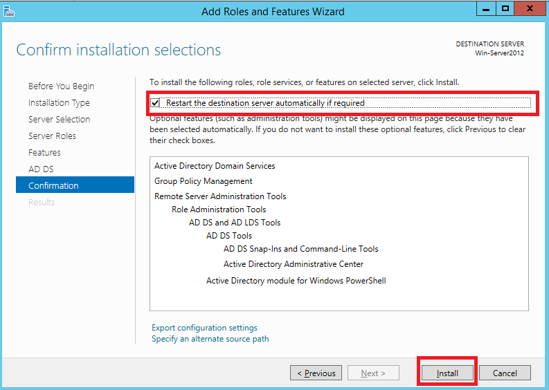

**Step 13.** Click Promote this server to a domain controller.

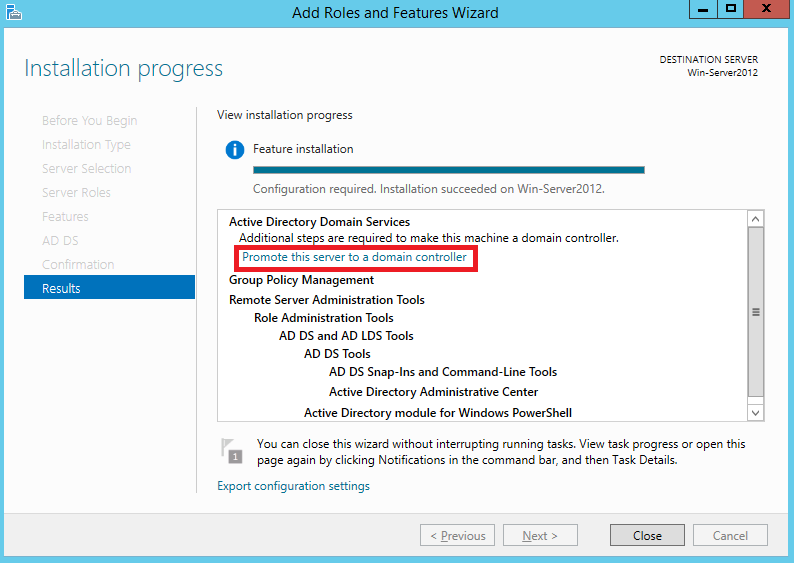

**Step 14.** In Deployment Configuration wizard, select Add a new forest, enter the Root domain name (Ex: Bkteam.com) and click Next

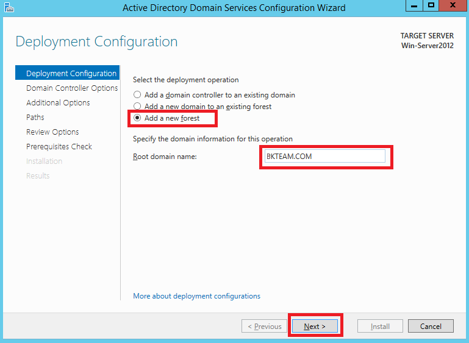

**Step 15.** In Domain Controller Options, change Forest and Domain functional level to Windows Server 2012 R2, and Domain Name System server. Type the Directory Services Restore Mode Password and Confirm password and click Next.

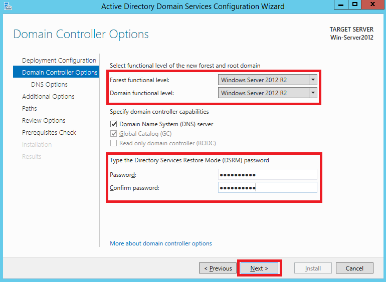

**Step 16.** On DNS Options page, click Next.

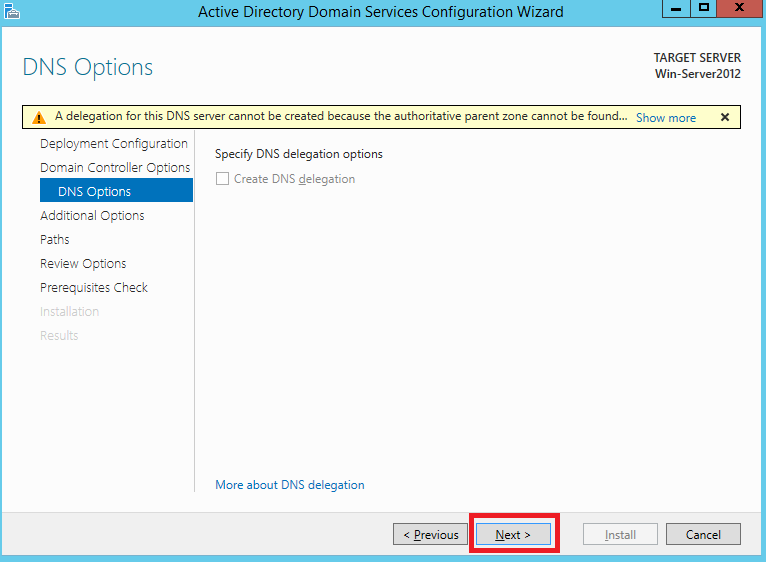

**Step 17.** Verify the NetBIOS domain name (Ex: BKTEAM), click Next.

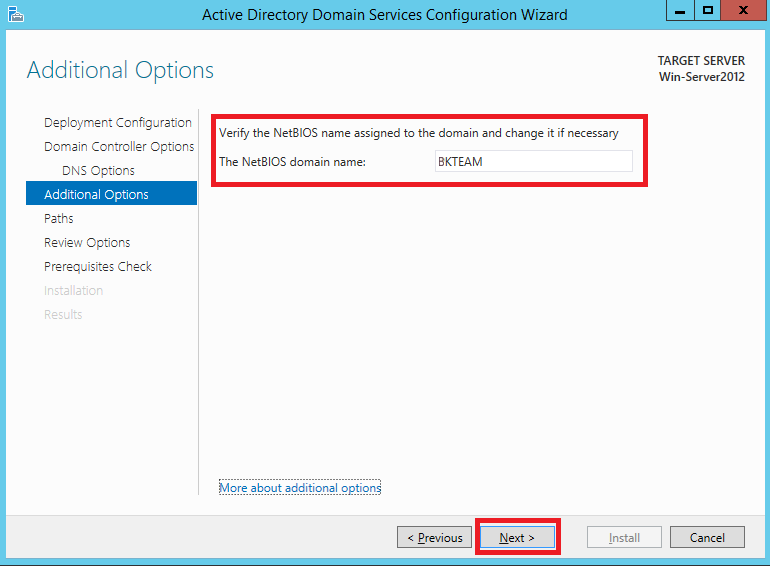

**Step 18.** Verify the location of the AD DS database, log files, and SYSVOL, click Next.

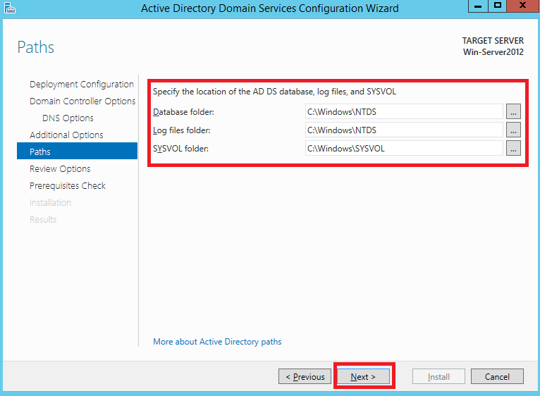

**Step 19.** Review the Summary and click Next.

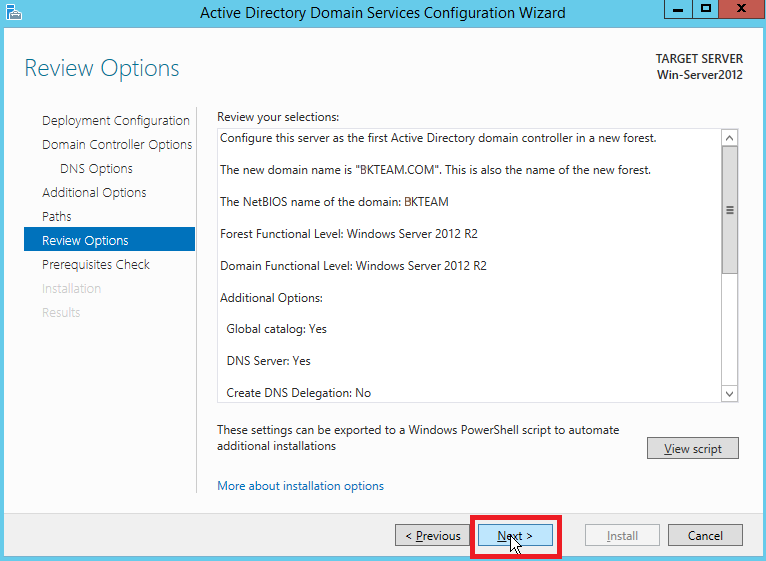

**Step 20.** After successfully checking pre-requisite Click Install to begin installation.

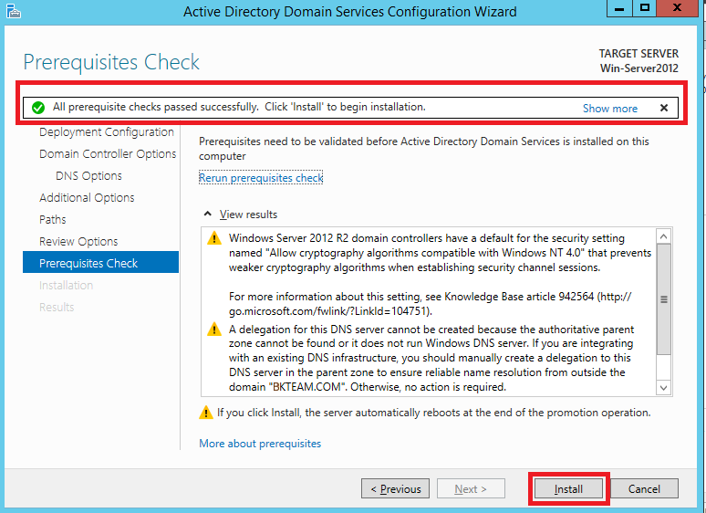

## Verification of Active Directory Domain Controller

**Step 1.** Click Server Manager.

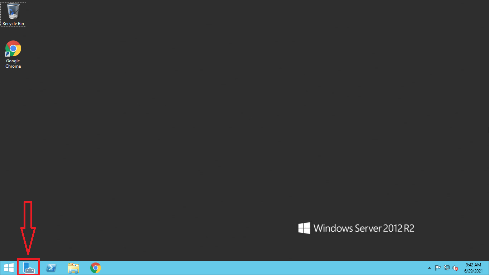

**Step 2.** In Server Manager, select Local Server, verify for Domain Bkteam.com

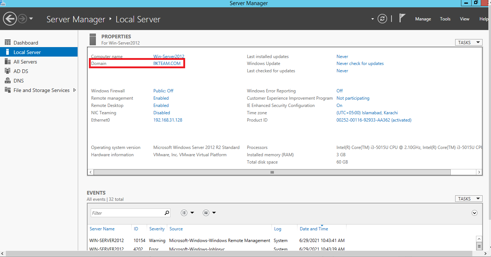

---
[← Lab 1](../lab-01-static-ip-address/) | [Active Directory](../README.md) | [Lab 3 →](../lab-03-join-client-to-domain/)
