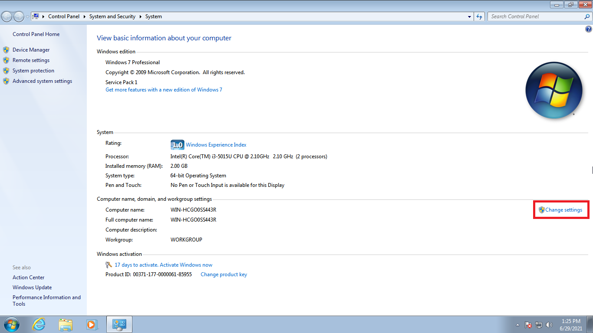
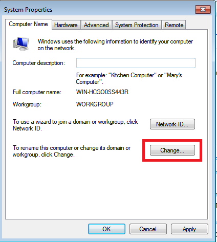
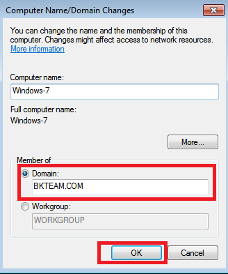
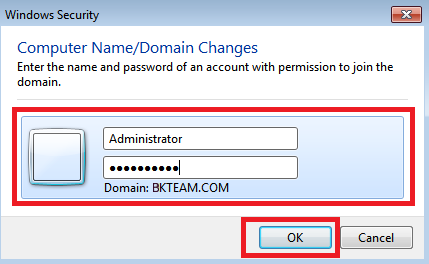
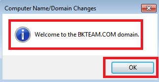
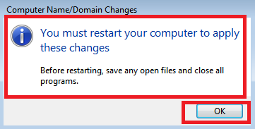
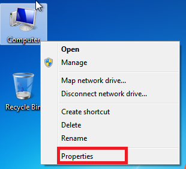
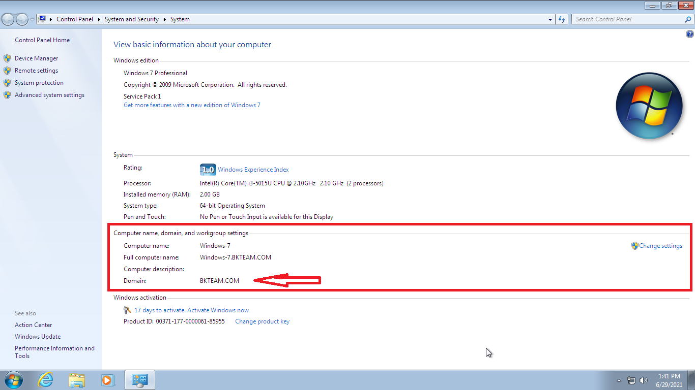

# Lab 3: Joining a Windows Client to the Domain

> **Objective:** Join a Windows 7 client to the `Bkteam.com` domain and verify the membership.

## Prerequisites

Before starting, you need:

- A computer running windows 2012 server Domain Controller.

- A computer running windows 2012 server or windows 7.

In this lab, Windows Server 2012 R2 runs the domain controller for the `Bkteam.com` domain, and a Windows 7 client joins it.

## Environment

**General Information Windows Server 2012 R2**

| Setting | Value |
|---|---|
| Server Name | Win-Server2012 |
| Domain Name | Bkteam.com |
| Forest Name | Bkteam.com |
| IP Address | 192.168.31.128 |
| DNS Server (Preferred) | 192.168.31.128 |
| DNS Server of ADC (Alternative) | 192.168.31.138 |

**General Information Client Windows 7**

| Setting | Value |
|---|---|
| Computer Name | Win-7 |
| IP Address | 192.168.31.129 |
| DNS Server (Preferred) | 192.168.31.128 |
| DNS Server (Alternative) | 192.168.31.138 |

## Procedure

**Step 1.** Log in as Administrator to Workgroup Computer.

**Step 2.** Right click Computer Icon and click Properties and click Change settings.

**Step 3.** In the System properties dialog box click Change.

**Step 4.** Select the Member of Domain and enter the Domain Name (Ex: Bkteam.com).

**Step 5.** Enter the user’s name Administrator and Password, click OK.

**Step 6.** Welcome Message appears indicating that the computer was successful in joining the Domain, click OK and OK, it will ask for restart, click Restart Now.

## Verification:

**Step 1.** Right click Computer Icon → Properties.

**Step 2.** Click Computer Name, domain, and workgroup settings and verify for the Domain Name Bkteam.com.

---
[← Lab 2](../lab-02-install-active-directory/) | [Active Directory](../README.md) | [Lab 4 →](../lab-04-ou-users-groups/)
