# Lab 4: Creating OUs, Domain Users and Groups

> **Objective:** Create an organizational unit, a security group and a domain user account in Active Directory Users and Computers.

## 4.1 - Creating OU in DC Windows Server 2012 R2.

**Step 1.** Log in as Administrator to the Domain Controller.

**Step 2.** Open Server Manager, select Tools from the top-right menu and then select Active Directory Users and Computers from the list. OR type command in run dsa.msc to open Active Directory User and Computers.

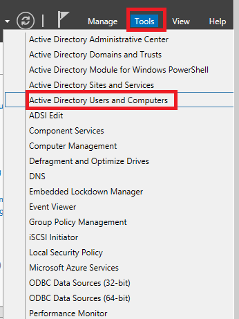

**Step 3.** Once Active Directory User and Computers is opened, select the domain name (Ex: Bkteam.com). Right Click and select New. Select Organizational Unit.

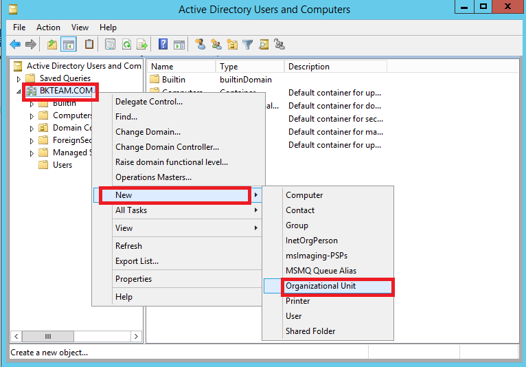

**Step 4.** Specify the name of the OU to create. In our case we named the OU Networks.

> **Note:** By default, any created Organizational Unit is protected from accidental deletion. To delete this OU, you need to clear this checkbox. When you delete OU, you delete all other (nested) objects that it contains.

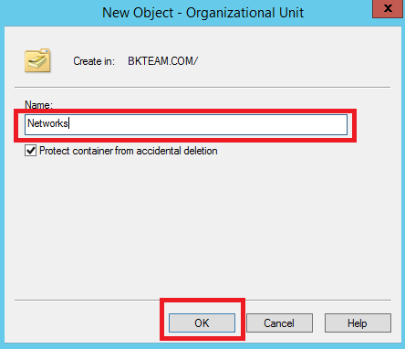

You can create multiple OUs as per your requirement to follow same procedure.

## 4.2 - Creating Domain Groups in DC Windows Server 2012 R2

**Step 1.** Log in as Administrator to the Domain Controller.

**Step 2.** Open Server Manager, select Tools from the top-right menu and then select Active Directory Users and Computers from the list. OR type command in run dsa.msc to open Active Directory User and Computers.

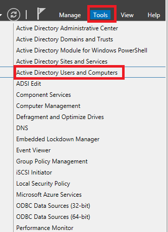

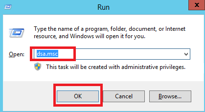

**Step 3.** Once Active Directory User and Computers is opened, Select the domain name (Ex: Bkteam.com). Select OU named (Ex: Networks) Right Click and select New, Select Group.

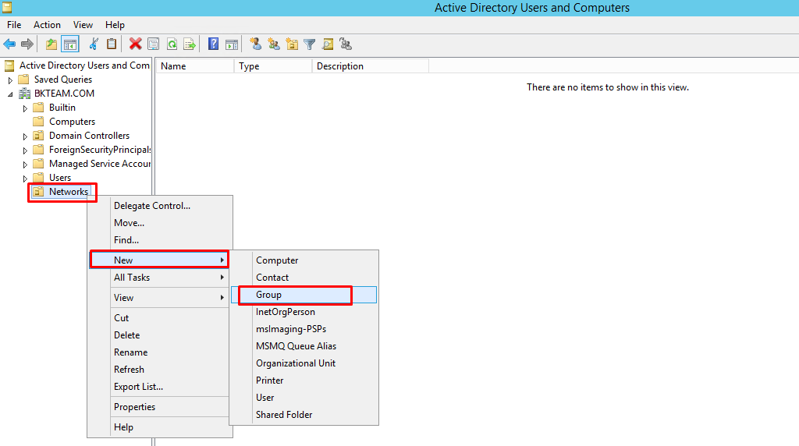

**Step 4.** Type the name of the new group (Ex: Network administrators). In the Group scope option, select Global. In Group type, choose Security. Click OK.

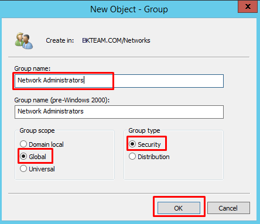

You can create multiple Groups as per your requirement to follow the same procedure.

## 4.3 - Creating Domain Users in DC Windows Server 2012 R2

**Step 1.** Log in as Administrator to the Domain Controller.

**Step 2.** Open Server Manager, select Tools from the top-right menu and then select Active Directory Users and Computers from the list. OR type command in run dsa.msc to open Active Directory User and Computers.

**Step 3.** Once Active Directory User and Computers is opened, In the console tree, expand your domain Bkteam.com, and then right click Users Container or other OU you want to add/create new users, select New User.

In our case we want to create users in Networks OU. But you can follow the same procedure for any OU container.

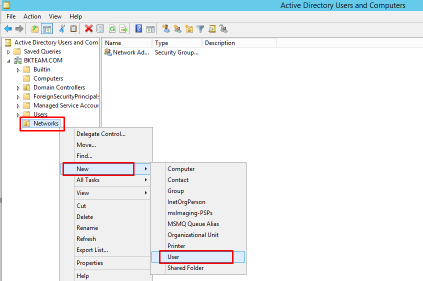

**Step 4.** Specify the First Name Last Name and User Logon Name and then click Next.

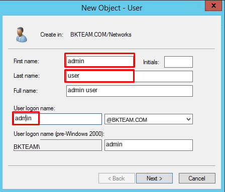

**Step 5.** Enter the Password and Confirm Password for the User account, click Next.

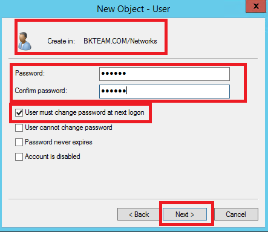

**Step 6.** Review the configuration settings for the User Account and then click Finish.

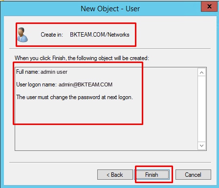

You can create multiple Users as per your requirement to follow the same procedure.

---
[← Lab 3](../lab-03-join-client-to-domain/) | [Active Directory](../README.md) | [Lab 5 →](../lab-05-additional-dc-same-network/)
