# Lab 5: Adding an Additional Domain Controller (Same Network)

> **Objective:** Add an additional domain controller to the existing domain on the same subnet for redundancy and load balancing.

In this lab we explain, step by step, how to install an additional domain controller in an existing active directory domain. Additional AD domain controller is used to balance the load among existing domain controllers. It also provides fault-tolerance that in case primary AD DC is down, additional AD DC can be used for authentications without any business discontinuity.

> **Important:** confirm the server details below match your environment.

**General Information Windows Server 2012 R2**

| Setting | Value |
|---|---|
| Server Name | Server2012-ADC |
| Domain Name | Bkteam.com |
| Forest Name | Bkteam.com |
| IP Address | 192.168.31.138 |
| DNS Server (Preferred) | 192.168.31.138 |
| DNS Server (Alternative) | 192.168.31.128 |

## Network Topology

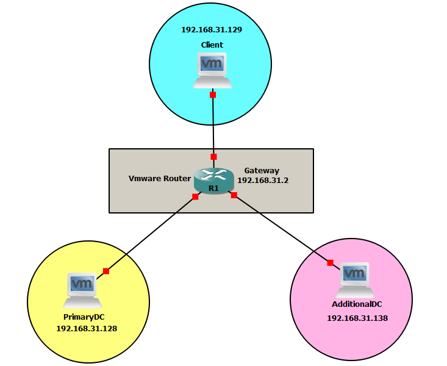

## Installing Active Directory Domain Services

**Step 1.** Open Server Manager dashboard from task bar and click Add roles and features

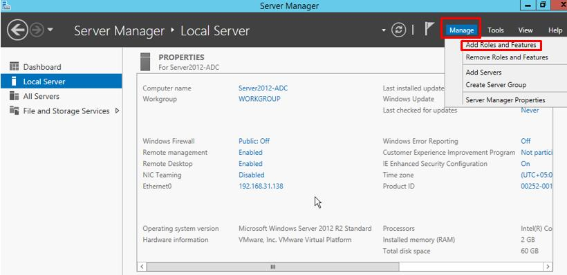

**Step 2.** Cross check the important notes Before you begin and click Next

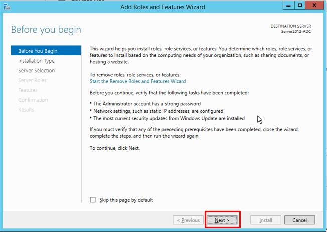

**Step 3.** In Select installation type Choose Role-based or feature-based installation and click Next

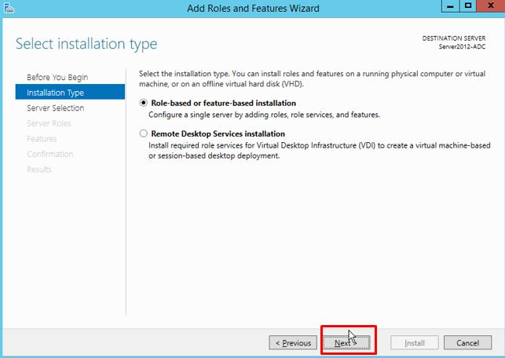

**Step 4.** Choose a desired destination server (Ex: Server2012-ADC) from server pool you want to configure it as additional domain controller and click Next

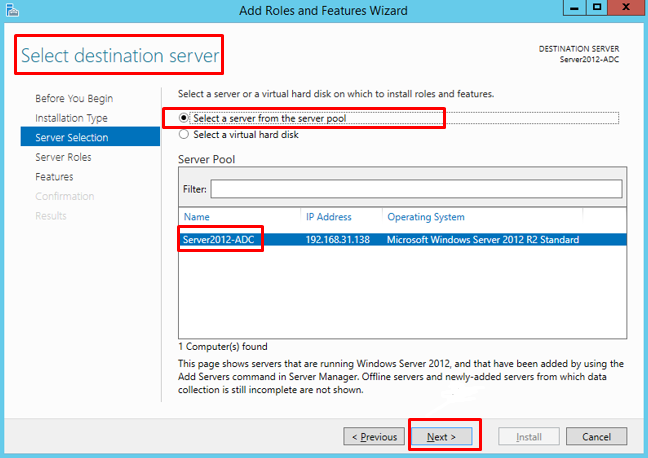

**Step 5.** Choose Active Directory Domain Services from roles.

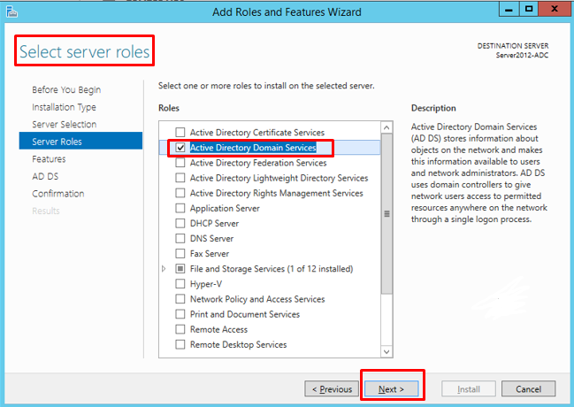

**Step 6.** As soon as you check the box, a small window will pop up prompting you to install other necessary features along with Active Directory Domain Services. Click Add Features

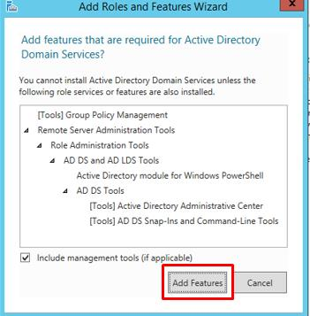

**Step 7.** In Select features wizard, click Next.

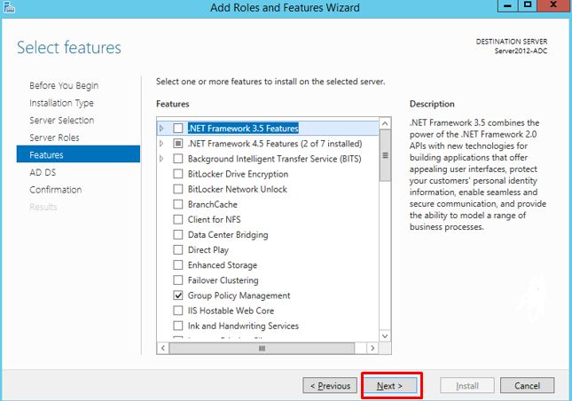

**Step 8.** Read related Active Directory Domain Services note and click Next

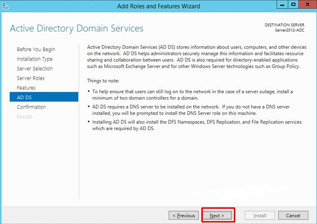

**Step 9.** Confirm your installation selections and click Install

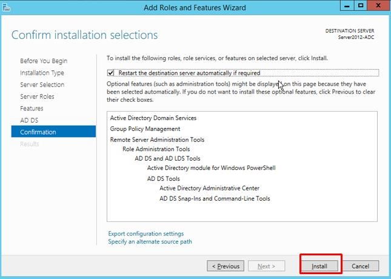

**Step 10.** It takes a while before an installation completes, click Promote this server to a domain controller.

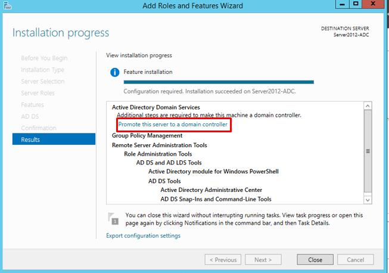

**Step 11.** Choose Add a domain controller to an existing domain. Provide a domain name and click Select. A security window will pop up, provide user name in the format <domain>\<username> (Ex: Bkteam.com\Administrator) and password. When done, click OK. Choose the domain from forest and click OK. Click Next

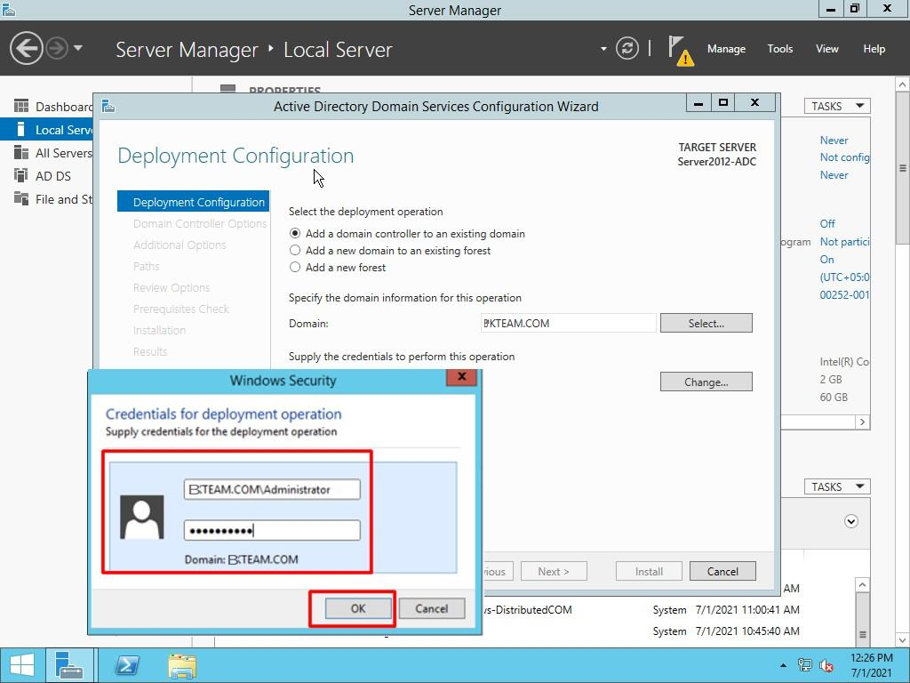

**Step 12.** Provide Directory Service Restore Mode (DSRM) password and click Next

**Step 13.** On DNS Options page, Ignore the warning and click Next

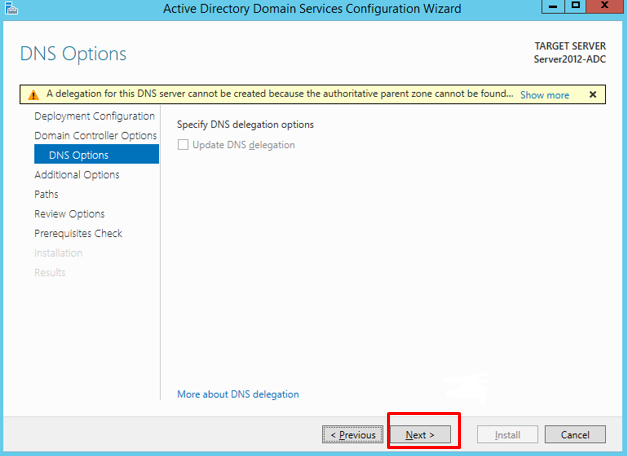

**Step 14.** Select your primary DC FQDN name (Ex: Win-Server2012.Bkteam.com) and Click Next

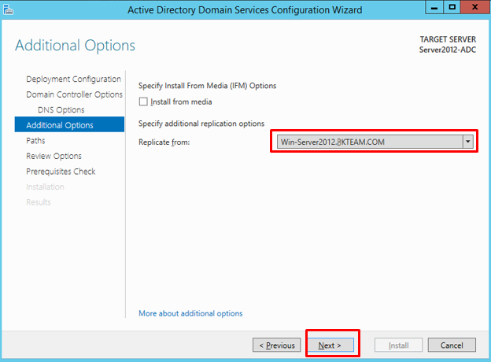

**Step 15.** Verify the location of the AD DS database, log files, and SYSVOL, click Next.

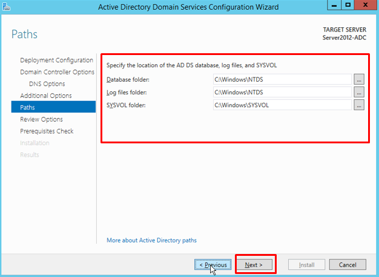

**Step 16.** Review the summary and click Next

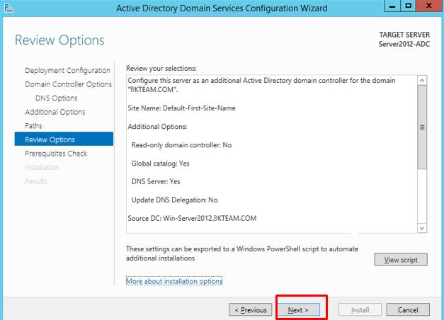

**Step 17.** After successfully checking pre-requisite Click Install to begin installation. Installation will begin and take few minutes to complete. After a successful configuration, click Close and server will be rebooted.

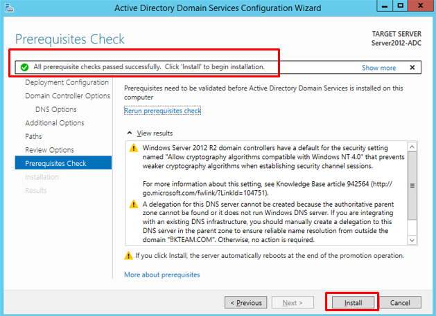

## Verification

The additional domain controller (ADC) is now configured and listed in the domain.

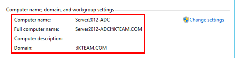

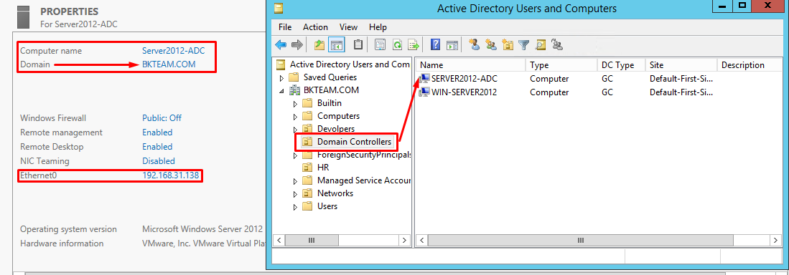

The additional domain controller is ready. You can add more backup domain controllers by repeating the same steps.

---
[← Lab 4](../lab-04-ou-users-groups/) | [Active Directory](../README.md) | [Lab 6 →](../lab-06-additional-dc-different-network/)
