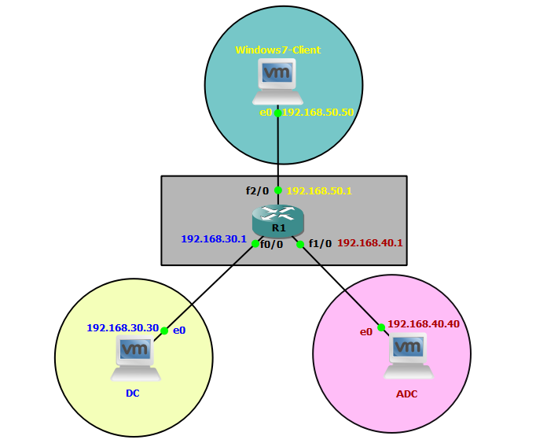
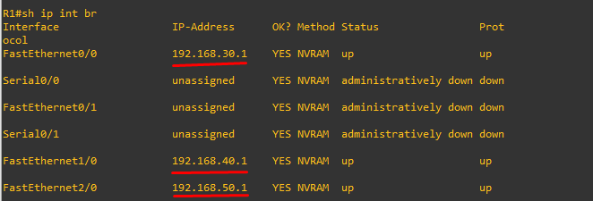
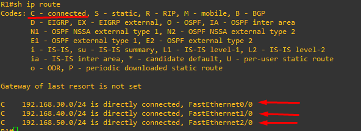
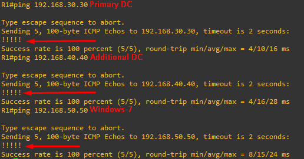
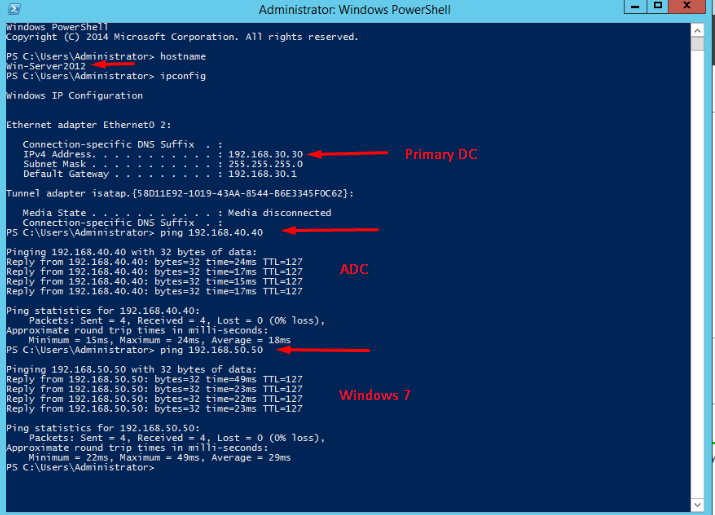
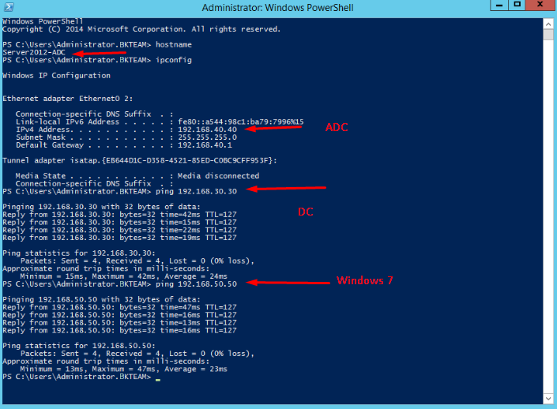
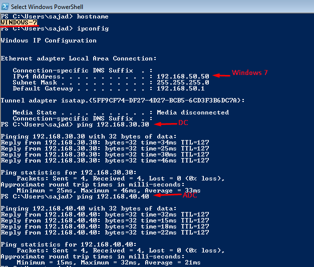
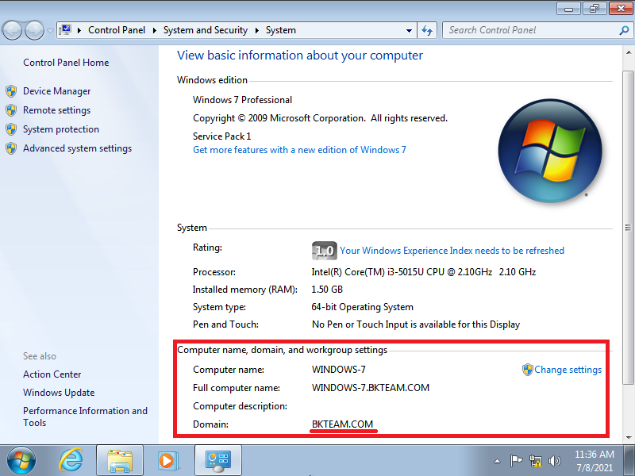
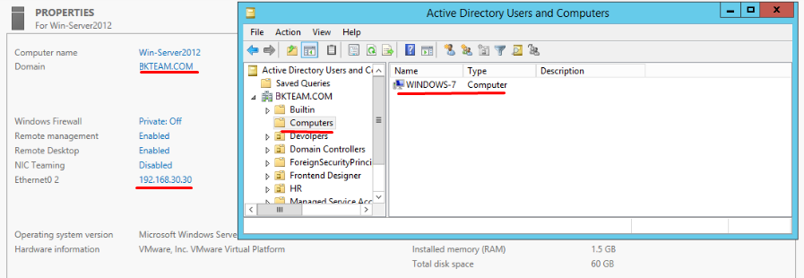

# Lab 6: Adding an Additional Domain Controller (Different Network)

> **Objective:** Add an additional domain controller located on a different subnet, using a GNS3 topology with a Cisco c3725 router.

In this lab we explain, step by step, how to install an additional domain controller in different networks in GNS3 and add to a primary DC. Additional AD domain controller is used to balance the load among existing domain controllers. It also provides fault-tolerance that in case primary AD DC is down, additional AD DC can be used for authentications without any business discontinuity.

## Server details

**General Information Windows Server 2012 R2 Primary DC**

| Setting | Value |
|---|---|
| Server Name | Win-Server2012 |
| Forest Name | Bkteam.com |
| IP Address | 192.168.30.30 |
| Gateway | 192.168.30.1 |
| DNS Server (Preferred) | 192.168.30.30 |
| DNS Server (Alternative) | 192.168.40.40 |

**General Information Windows Server 2012 R2 ADC**

| Setting | Value |
|---|---|
| Server Name | Server2012-ADC |
| Forest Name | Bkteam.com |
| IP Address | 192.168.40.40 |
| Gateway | 192.168.40.1 |
| DNS Server (Preferred) | 192.168.40.40 |
| DNS Server (Alternative) | 192.168.30.30 |

**General Information Windows 7 Client**

| Setting | Value |
|---|---|
| Server Name | Windows-7 |
| IP Address | 192.168.50.50 |
| Gateway | 192.168.50.1 |
| DNS Server (Preferred) | 192.168.30.30 |
| DNS Server (Alternative) | 192.168.40.40 |

## Network Topology

We have installed GNS3 VM in VMware workstation and integrated with GNS3 Client and after integration we have imported VMs (DC, ADC and Windows 7 - Client) to GNS3. In our network topology we create 3 different networks and connected through a router in GNS3.

- DC `Win-Server2012.Bkteam.com`: network `192.168.30.0/24`

- ADC `Server2012-ADC.Bkteam.com`: network `192.168.40.0/24`

- Windows 7 client: network `192.168.50.0/24`

The three networks communicate through a Cisco c3725 router in GNS3, configured as follows.



## Router c3725 Configuration

```text
Router> enable
Router# configure terminal
Router(config)# hostname R1
R1(config)# interface FastEthernet0/0
R1(config-if)# ip address 192.168.30.1 255.255.255.0
R1(config-if)# no shutdown
R1(config-if)# exit
R1(config)# interface FastEthernet1/0
R1(config-if)# ip address 192.168.40.1 255.255.255.0
R1(config-if)# no shutdown
R1(config-if)# exit
R1(config)# interface FastEthernet2/0
R1(config-if)# ip address 192.168.50.1 255.255.255.0
R1(config-if)# no shutdown
R1(config-if)# exit
R1(config)# exit
Router# copy running-config startup-config //Saving Running-Configuration to NVRAM
```

## Verification





## Network Connectivity Checking (DC, ADC, Windows-7)









## Domain Joining Verification

Now we have joined domain (Ex: Bkteam.com). The domain-join procedure is covered in [Lab 3](../lab-03-join-client-to-domain/).





---
[← Lab 5](../lab-05-additional-dc-same-network/) | [Active Directory](../README.md) | [Lab 7 →](../lab-07-seize-fsmo-roles/)
