# Lab 7: Seizing FSMO Roles from a Failed Domain Controller

> **Objective:** Seize all five FSMO roles on the additional domain controller after the primary domain controller has failed.

## Operations Masters

Active Directory is a multi-master system where each domain controller has autonomy for read and write operations there are however five special Flexible Single Master Operation Roles (FSMO) which must be assigned to specific domain controllers. All roles can be assigned to a single domain controller or can be distributed between domain controllers.

**FSMO Roles Details**

| Role | Scope | Description |
|---|---|---|
| Schema Master | Forest | The Schema Master FSMO role owner is the domain controller responsible for making any changes to the forest’s schema and the only server in the forest capable of performing updates to the directory schema |
| Domain Naming Master | Forest | The domain naming role is used when adding or removing domains in the forest. When you add or remove a domain, the domain naming master must be accessible, or the operation will fail. |
| Infrastructure Master | Domain | Stores data about users from other domains, that are added to domain |
| RID Master | Domain | RID master (Relative Identifier) responsible for assigning unique relative ID (RID), required when creating domain objects (user and computer accounts, groups, contacts, etc.). There can be one for each domain in the forest. |
| PDC Emulator | Domain | PDC (Primary Domain Controller) Emulator responsible for compatibility with NT4 domain and pre-Windows 2000 clients, for the domain time synchronization in the forest, for changing passwords, and manages lockouts when users enter the wrong password. |

## Seizing FSMO Roles

In case primary domain controller, which owns FSMO (Flexible Single Master Operation) roles is fail (virus attack, fatal software problems or catastrophic hardware failure etc.), then you need to transfer FSMO roles from a failed to another additional domain controller for proper Active Directory domain functioning.

Suppose, in our Active Directory domain there are 2 domain controllers, that is running Windows Server 2012 R2:

- PDC – Win-Server2012.Bkteam.com

- Secondary DC – Server2012-ADC.Bkteam.com

After the failure of the PDC, we need to seize the FSMO roles from PDC to a secondary domain controller. Then on the Secondary DC, we need to delete all references to the primary DC.

> **Important:** Before you begin, make sure your account is a member of a following AD groups: Domain Admins and Schema Admins.

## Our Scenario:

Primary DC Name Win-Server2012.Bkteam.com, Secondary DC Name Server2012-ADC.Bkteam.com running on VM windows server 2012 R2.

All the five roles were on PDC Win-Server2012.Bkteam.com, so we are going to seize all the five roles to Server2012-ADC.Bkteam.com, which is our ADC.

> **Note:** Before proceeding with the steps make sure about which dc is holding which role, you can verify it by using netdom query fsmo.

So, we have run the command and its shows that all 5 FSMO roles associated to PDC which is dead/down. Now we are seizing fsmo roles from PDC to ADC.

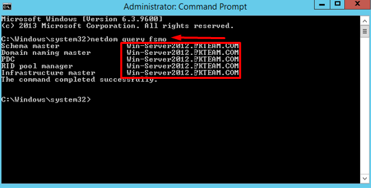

## Steps To Seize FSMO Roles On ADC

**Step 1.** Login to ADC by the administrator credential.

**Step 2.** Open Command prompt (Admin).

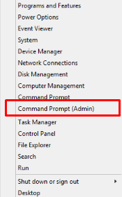

**Step 3.** Type ntdsutil and press enter.

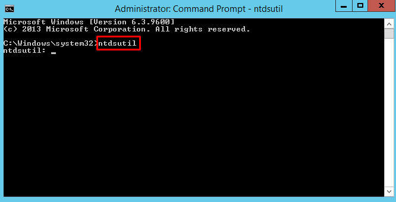

**Step 4.** Now you type roles and hit enter. You will be entered in a fsmo maintenance mode.

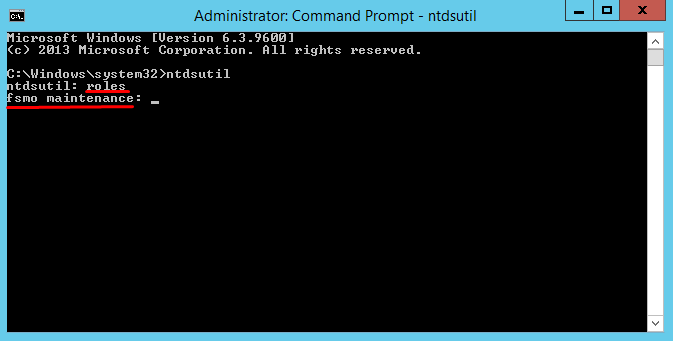

**Step 5.** Now type connections and press enter, you will get the option for server connections.

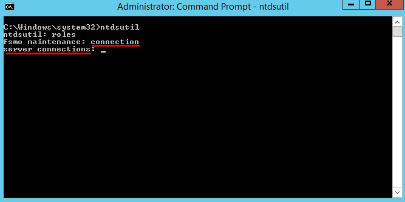

**Step 6.** Now you need to connect with the server on which you want to seize the roles, as in our case we are seizing roles on our ADC, so will type the name of our ADC (Ex: Server2012-ADC.Bkteam.com) 

```text
connect to server Server2012-ADC.Bkteam.com
```

Replace `Server2012-ADC.Bkteam.com` with the name of the server on which you want to seize the roles.

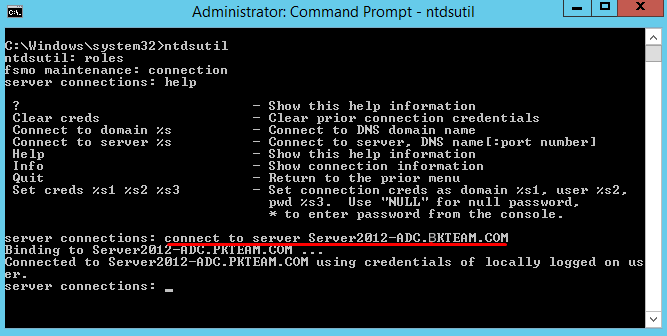

**Step 7.** Once you see the above screen, then you can type quit to exit it.

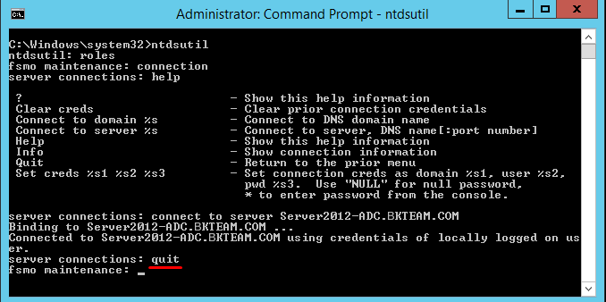

**Step 8.** If you see the above screen, now you can start fsmo roles seizure one by one. Run the following commands one by one:

- Run `seize domain naming master` and press Enter.
- Run `seize infrastructure master` and press Enter.
- Run `seize pdc` and press Enter.
- Run `seize rid master` and press Enter.
- Run `seize schema master` and press Enter.
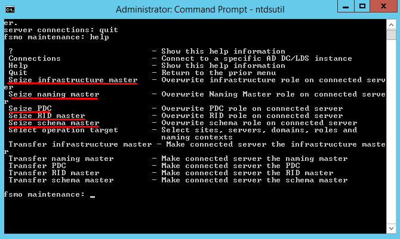

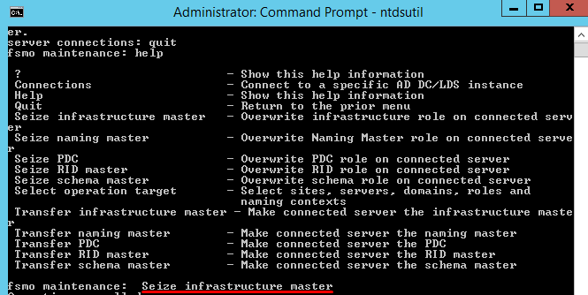

> **Note:** First Server will try to connect the main dc and will try to transfer the fsmo role, but as we do not have dc in place now, so the transfer will be failed and you will see the message, transfer of fsmo roles has been failed and proceeding with seizure.

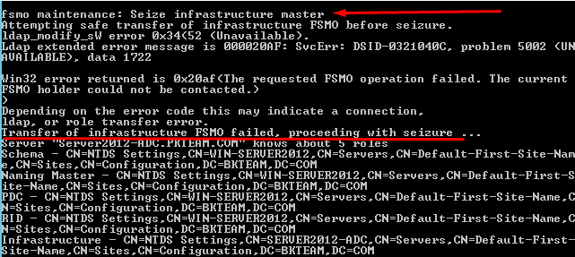

**Step 9.** Every time after entering seizing command entering a notification box will appear, you need to just click on yes.

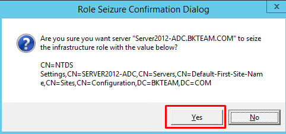

You can safely seize the rest of the fsmo roles and once all the roles are seized. Press quit to quit the fsmo maintenance mode.

- Run `seize domain naming master` and press Enter.
- Run `seize pdc` and press Enter.
- Run `seize rid master` and press Enter.
- Run `seize schema master` and press Enter.
## Verification

**Step 1.** After proceeding with the above steps now we are checking the FSMO roles seizing successfully or not, we can verify it by using netdom query fsmo command in command prompt.

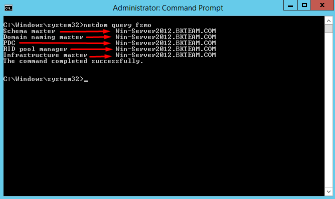

So FSMO roles successfully seized to Additional Domain Controller. Now they will perform as a Primary Domain Controller.

---
[← Lab 6](../lab-06-additional-dc-different-network/) | [Active Directory](../README.md)
