# Lab 1: Backing Up Active Directory with Windows Server Backup

> **Objective:** Install Windows Server Backup and schedule a daily full-server backup of the domain controller.

**Step 1.** Click Server Manager.

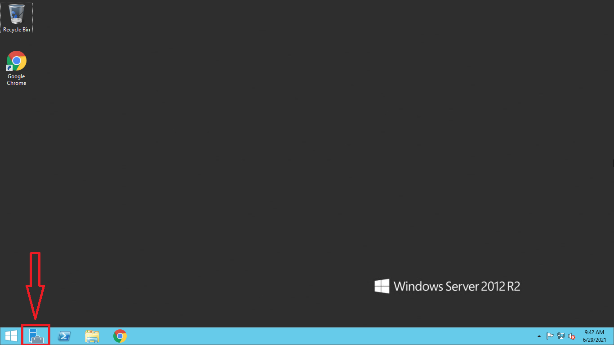

**Step 2.** In Server Manager Dashboard, Click Add roles and features.

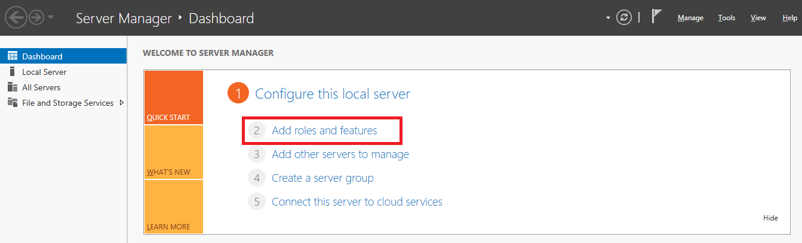

**Step 3.** In Before you begin page, click Next.

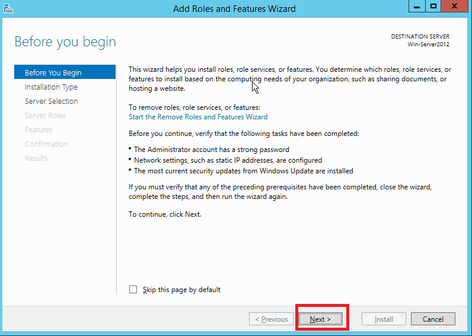

**Step 4.** In Select installation type, select Role-based or feature-based installation, click Next.

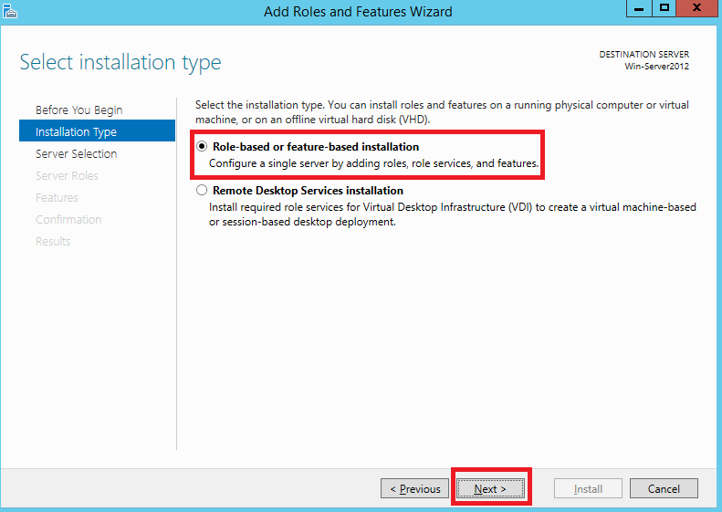

**Step 5.** In Select destination server from Server Pool select Win-Server 2012, click Next.

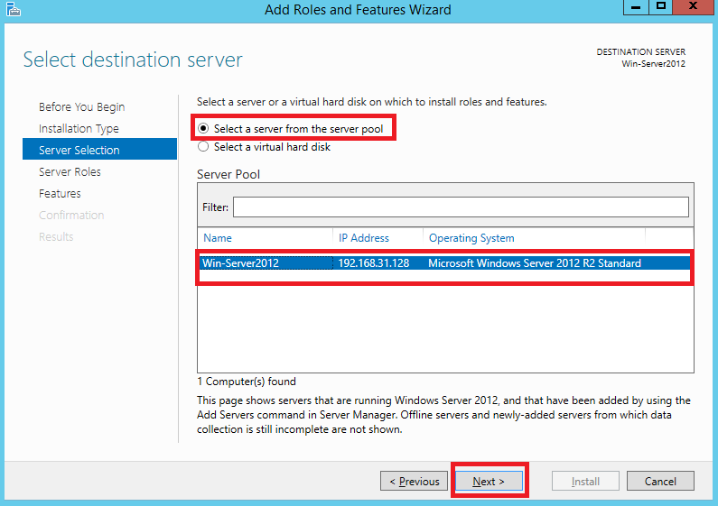

**Step 6.** Then go next to Features. check the Windows Server Backup box and then click on Next

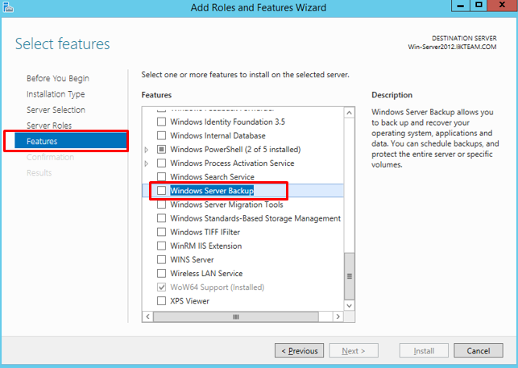

**Step 7.** Click Install and then wait for the process to Finish.

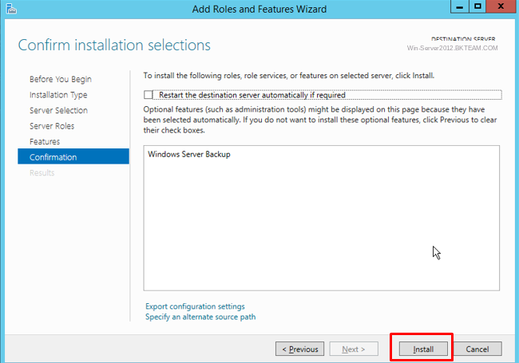

**Step 8.** Wait for the installation of Windows Server Backup to complete and click Close.

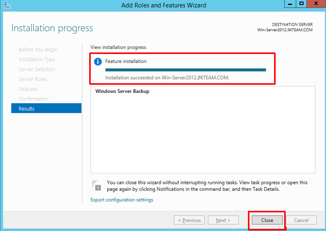

**Step 9.** Now go to Server Manager select Tools > Windows Server Backup.

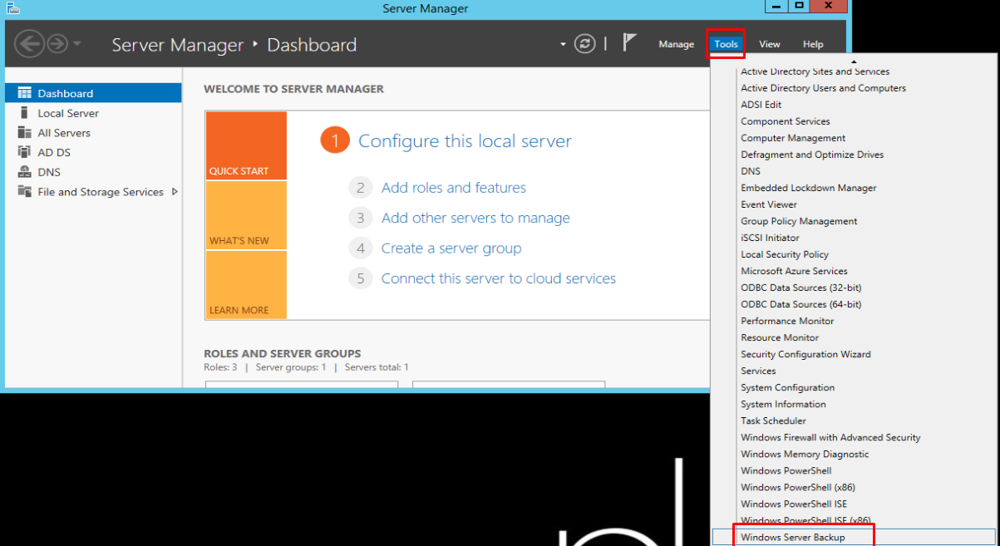

**Step 10.** Right click on Local Backup item in the left pane and select Backup Schedule.

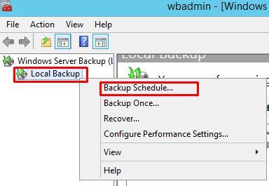

**Step 11.** On Getting Started window, Click Next.

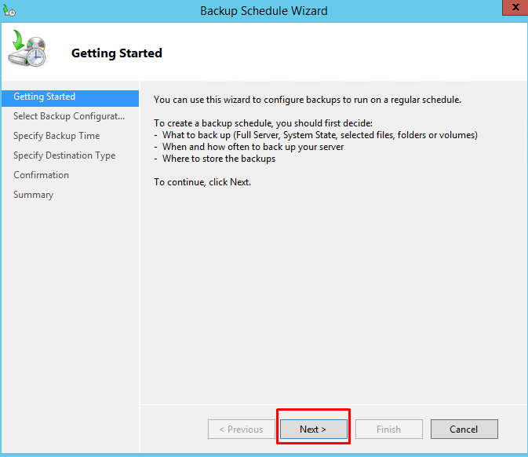

**Step 12.** If you want to backup a file or a folder, you can click on custom file, but in this case, we want to take full backup of the server. So, we should click on the first option Full server (recommended) and then click Next.

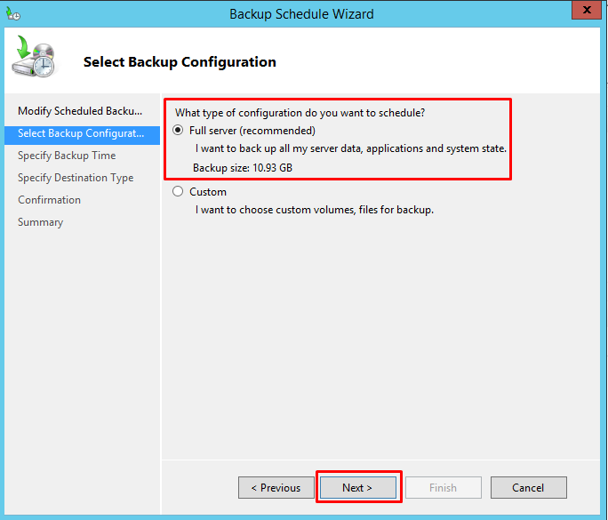

**Step 13.** We should do backup once in a day, so we will choose the first option and the appropriate time, and click Next.

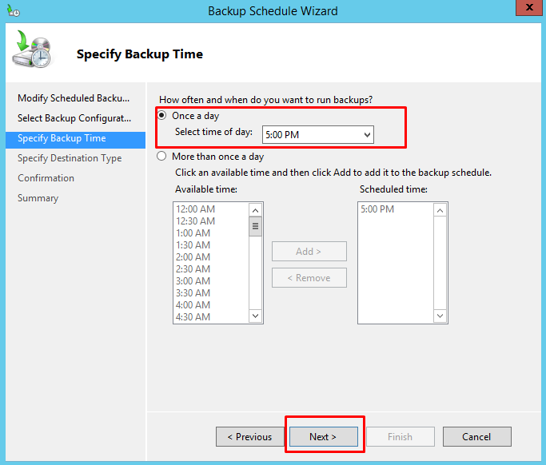

**Step 14.** We can back up our DC to a dedicated backup volume, or a shared network folder. We are using a back up to a volume, and click next.

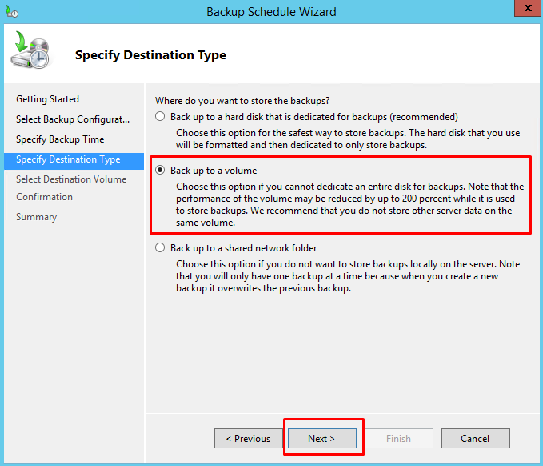

**Step 15.** Add your volume where you want to take Back up.

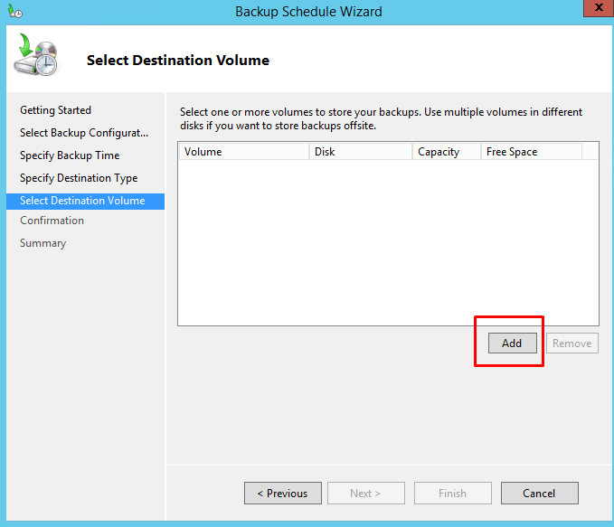

**Step 16.** Select your Destination Volume (Ex: Backup E) and click OK.

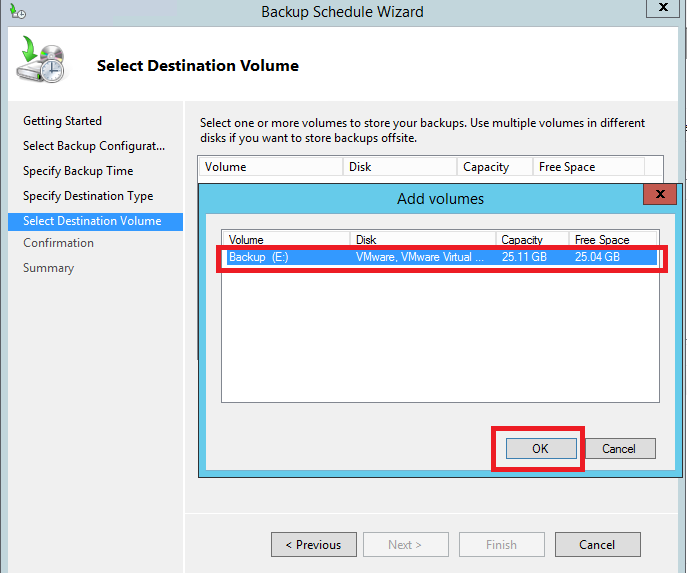

**Step 17.** After select your destination volume for back up, Click on Next.

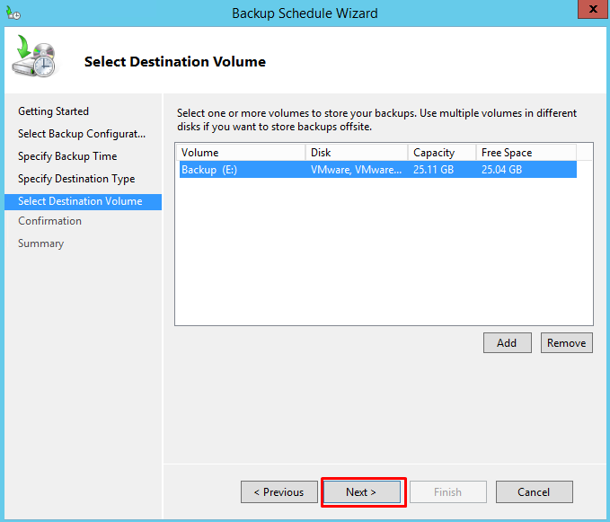

**Step 18.** Review the confirmation Press Finish to create a backup task.

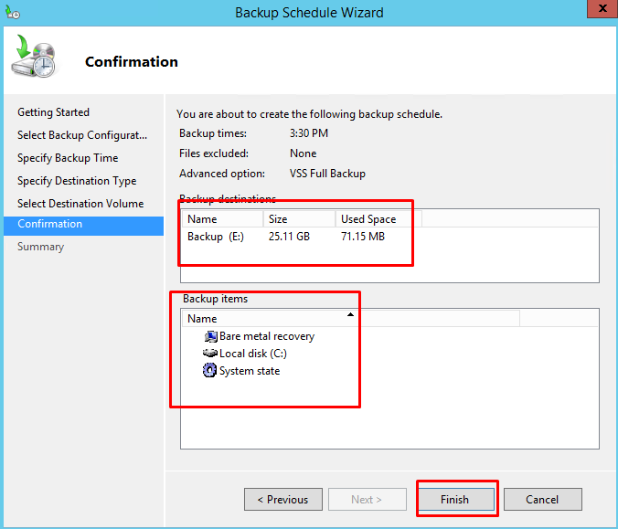

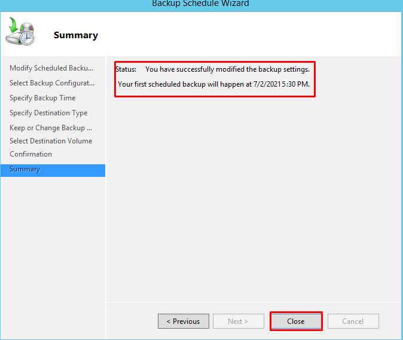

**Step 19.** Now you will get a window showing the status if the backup was created successfully.

## Verification

**Step 1.** Backup successfully Saved in Destination Volume.

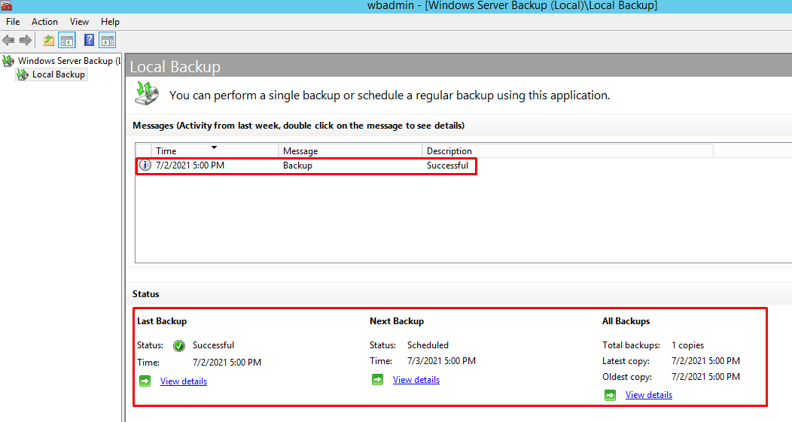

---
[Backup and Recovery](../README.md)
