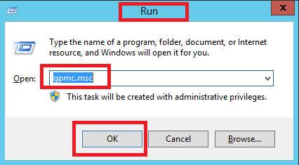
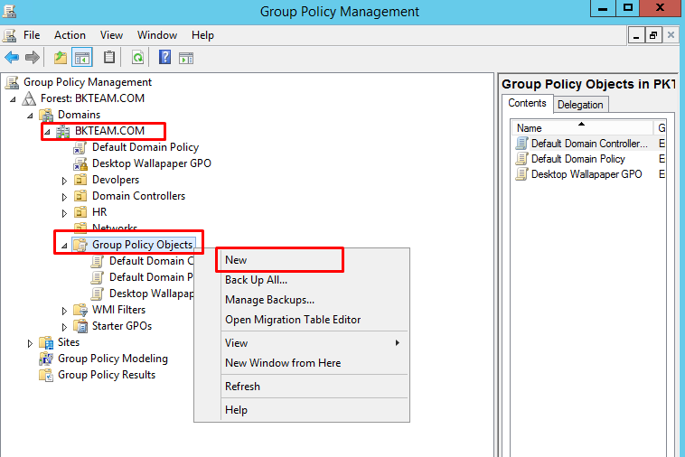
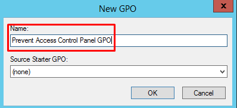
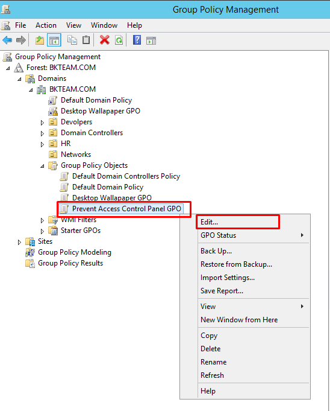
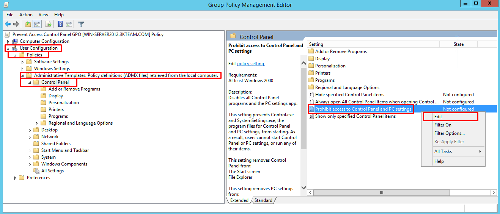
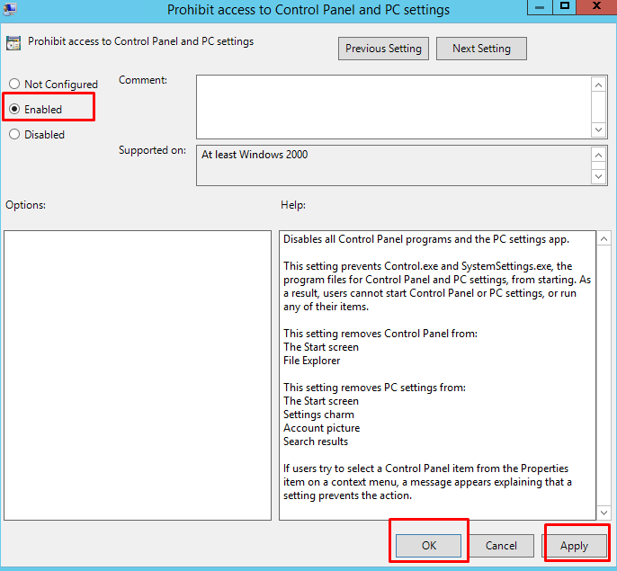
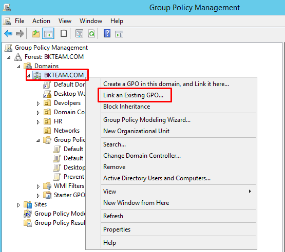
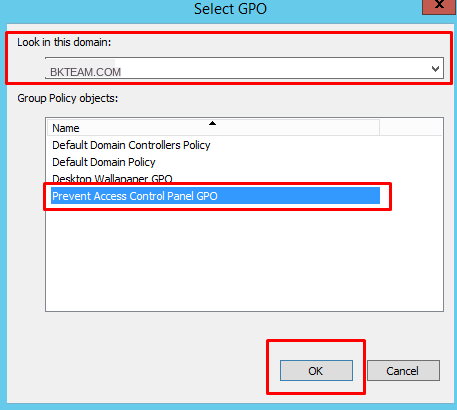
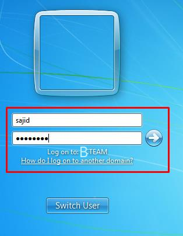
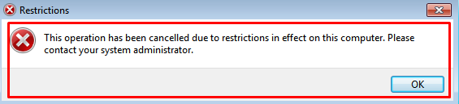

# Lab 1: Creating a GPO to Restrict Access to Control Panel

> **Objective:** Create and link a Group Policy Object that prevents domain users from opening Control Panel.

**Step 1.** Open run and type gpmc.msc enter OK select the GPO to which you will add the policy.

**Step 2.** Create a new group policy.

**Step 3.** Enter a name for the new group policy (Ex: Prevent Access Control Panel GPO)

**Step 4.** On the Group Policy Management screen, expand the folder named Group Policy Objects and Right-click your new Group Policy Object (Ex: Prevent Access Control Panel GPO) and select the Edit option.

**Step 5.** On the group policy editor screen, expand the User configuration folder and locate the following item and open the GPO named Prohibit access to Control Panel and PC settings. User Configuration > Policies > Administrative Templates > Control Panel

**Step 6.** Enable the item named Prohibit access to Control Panel and PC settings and click on Apply and OK.

**Step 7.** On the Group policy management screen, Right-click the Domain / Organizational Unit desired and select the option to link an existent GPO.

**Step 8.** In our example, we are going to link the group policy named Prevent Access Control Panel GPO to the root of the domain (Bkteam.com).

After applying the GPO, you need to wait for 10 or 20 minutes or run the command in Run (gpupdate /force) to take effect immediately.

## Verification

**Step 1.** Login On a remote computer via domain user.

**Step 2.** Try to access the Control panel you will get a message of restriction.

In our example, we have successfully implemented GPO to prevent access to the Control Panel.

---
[Group Policy](../README.md)
